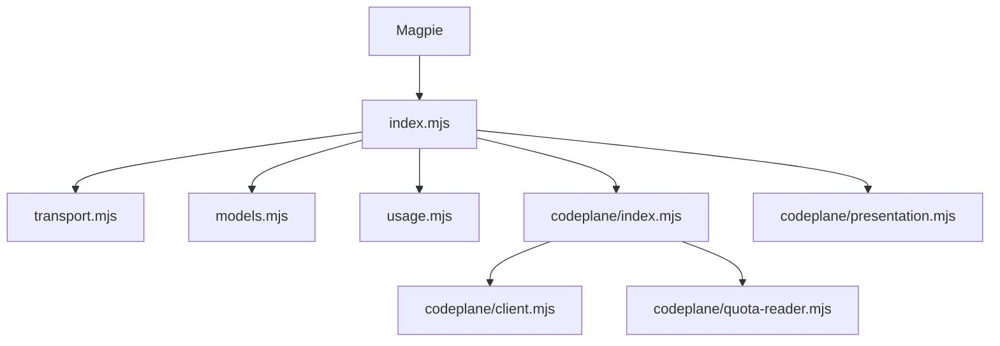

# 架构说明

插件使用原生 ESM，无运行时依赖和构建步骤。唯一包入口为 `index.mjs`，只导出 `TetPlugin`。用户操作与选项见[登录与配置](configuration.md)，数据归属见[领域术语](../GLOSSARY.md)。

TET 是网关和插件名称，TET CodePlane 提供账户认证、网关配置与共享资源查询。两者地址、凭据和失败状态分别处理。

## 模块职责

| 模块                             | 职责                                                         |
| -------------------------------- | ------------------------------------------------------------ |
| `index.mjs`                      | 注册供应商、两种登录方式、模型与用量钩子，衔接宿主认证存储   |
| `src/config.mjs`                 | 校验地址、规范化网关路径和选项；账号地址优先于包级 `baseURL` |
| `src/transport.mjs`              | 网关凭据读取、有界查询、在途查询合并及按协议认证转发         |
| `src/protocols.mjs`              | 已知协议到宿主适配器的映射及生成端点白名单                   |
| `src/errors.mjs`                 | 安全错误分类和 `Retry-After` 校验                            |
| `src/models.mjs`                 | 目录分页、有效模型 ID 筛选、协议选择及元数据覆盖             |
| `src/usage.mjs`                  | 网关钱包、消费、密钥与订阅限额的宿主窗口映射                 |
| `src/codeplane/index.mjs`        | TET CodePlane 账号登录、会话恢复、认证状态与用量读取编排     |
| `src/codeplane/client.mjs`       | TET CodePlane 地址校验、请求发送及响应信封校验               |
| `src/codeplane/quota-reader.mjs` | 动态分组分页、上游去重和有界并发读取                         |
| `src/codeplane/presentation.mjs` | TET CodePlane 周期、重置次数、并发及来源标签的窗口映射       |
| `assets/logo.svg`                | 图标来源；`bun run sync-icon` 将其同步到包元数据             |

宿主钩子通过 `createCodePlane` 创建 TET CodePlane 模块，使用其 `authorizeAccount`、`refresh` 和 `read`。地址校验使用 `codePlaneBase`，窗口映射使用 `mapCodePlaneUsage` 和 `presentCodePlaneUsage`。原先将 API Key 与 TET CodePlane 共享额度绑定的入口已经删除，既有绑定仍由读取与会话恢复流程兼容；不会为历史兼容保留创建旧绑定的生产入口。

为兼容已保存认证和宿主问题输入，`metadata.management` 及 `managementURL`、`managementUsername`、`managementPassword`、`managementGroup` 保留原字段名。系统名称和模块路径调整不要求迁移或删除已有认证。

## 网关请求与模型

登录、已保存账号、包级配置和请求共用网关地址规范化规则：纯站点地址补 `/v1`，显式 API 路径保持不变。TET CodePlane 地址独立校验，不从 TET CodePlane 地址猜测网关地址。

查询仅访问配置地址的指定端点并拒绝重定向。每个响应和累计模型目录最多 4 MiB，模型目录最多 20 页。同地址、同 Key 的相同在途查询合并，完成后不缓存结果。分页循环、越界路径和过大目录均失败，不返回看似完整的截断目录。

生成只允许配置网关下已知协议的端点：Responses（含 Compact）、Chat Completions、Anthropic Messages 和 Gemini GenerateContent（含流式）。协议由模型的宿主适配器决定，不靠模型名称推断；不同协议使用 Bearer、`x-api-key` 或 `x-goog-api-key` 注入同一账号的当前网关 Key。所有转发仍限定账号的网关地址和路径前缀，不允许重定向或任意端点。转发保留请求正文、流式响应和取消信号，不删除响应 ID、不改写历史，也不将 Compact 请求改成普通生成。显式多轮历史和工具结果原样通过；插件不依赖 `store` 或 `previous_response_id`，也不自动切换协议重试。

模型目录不按版本、品牌或模态名称过滤。协议依次取模型显式覆盖、宿主已知适配器和站点默认（兼容默认 Responses）；当前目录没有可靠的协议字段，不虚构字段映射。模型能力依次取显式覆盖、宿主已有信息和保守默认，输入输出模态未知时不声明，不覆盖已有非文本模态。目录刷新不发送付费生成请求，也不因一次生成失败永久隐藏模型。元数据策略与配置示例见[登录与配置](configuration.md)。

## 认证生命周期

TET CodePlane 会话与网关 Key 分开传递和保存。TET CodePlane 账号登录使用宿主会话认证存储及 `auth.refresh` 调度；模型调用和网关用量始终使用网关 Key。宿主的 `refresh` 字段保存稳定账号标识，不代表服务端提供了 refresh token。

每次生成请求发送前重新读取当前账号凭据。同一网关地址更换 Key 后，旧 loader 也使用新 Key；网关地址发生变化时，旧 loader 拒绝继续发送并要求重载，避免把新站点凭据发往旧地址。

TET CodePlane 账号登录要求服务端返回用户标识、有效会话到期时间和可用网关 Key。Key 优先使用登录响应，缺失时读取 `/api/auth/profile/gateway-config`。网关地址来自明确填写的地址或服务端 `codexGatewayUrl`、`gatewayPublicBaseUrl`，不根据 TET CodePlane 地址推测。

距离会话到期不足 5 分钟或已经到期时，先请求 `/api/auth/me`。只有有效新 token 或更晚的到期时间才算明确续期；普通用户信息响应不算成功。无法续期时使用已保存密码重新登录。服务端提前返回 401 时也恢复会话，并将失败查询重试一次。

并发恢复合并登录，恢复失败后退避 30 秒。新会话通过宿主账号作用域的认证接口保存。TET CodePlane 账号登录由宿主续期调度触发，旧绑定在用量读取时恢复，不额外创建后台轮询。旧绑定没有密码时，需要用户重新选择 TET CodePlane 账号登录。

共享 TET CodePlane 读取完成后，各宿主账号分别保存自己的恢复会话，不将保存动作合并到共享请求中。旧用量查询保存恢复结果前会重新读取认证；用户已经退出或替换登录时，不写回旧认证，避免覆盖用户的新登录状态。

TET CodePlane 账号登录的网关 Key 随会话恢复结果更新，网关地址保持用户确认的值；身份变化要求重新登录。账号、密码和 TET CodePlane token 只保存在该登录项的认证数据中，不进入日志或用量结果。TET CodePlane 认证失败不将有效网关 Key 标记为过期。

## TET CodePlane 额度读取

每次刷新重新获取当前账号可见的全部分组及关联上游，跟随新增、删除、改名和迁移。忽略历史认证中的固定分组字段；有效会话无需重新登录，零分组也不阻止登录和钱包读取。

列表中的分组 ID 不是额度查询 ID。额度按最新列表返回的上游账号 ID 读取；跨分组的相同上游只读取一次，再关联回各分组。同一 TET CodePlane 会话的并发刷新共享整轮在途请求，完成后不跨刷新缓存额度。

单轮请求量为“分组列表页数 + 2 × 不同上游数”，不包含登录、认证失败后的单次重试和独立的钱包查询。最多同时查询两个上游，即四个 HTTP 请求。自动登录、列表分页和上游读取共用最多 5 秒的总预算；配置的查询超时更短时使用更短值。

列表失败时不展示旧分组；单个上游的用量或重置查询失败仅影响该项。TET CodePlane 超时以辅助状态展示，保留已成功读取的钱包和消费。不额外轮询，不导入 TET CodePlane 历史趋势。

## 用量与展示约束

钱包只使用原生顶层余额，不创建重复窗口。钱包可与真实密钥或订阅限额同时显示，但不相加。`quota_limited` 模式仅采用密钥限制，忽略残留订阅数据；其他模式只有有效订阅信息才展示订阅额度和有效期。订阅只有有效期时不创建进度条。

真实限额的 `amount`、`limit` 和 `unit` 保留原始精度，由宿主绘制进度。格式化金额使用两位小数，不足 0.01 的非零金额以 `<$0.01`、`>-$0.01` 等边界显示，避免显示为零。钱包采用 `9,999,998,956.88 USD` 形式；今日、累计消费使用 `$` 前缀，请求数使用 `req 221` 形式。金额与请求数完整显示，Token 和 TPM 使用紧凑格式。

今日、累计和流量属于 `aside` 辅助信息。TET CodePlane 共享周期额度、重置次数和分组并发也只供展示，不参与路由，不能解释为当前 Key 的独占额度或实际路由归属。

窗口采用宿主原生扁平双列布局：真实限额优先，Key 消费和流量在分组信息前；各分组相邻展示 `5h`、`7d`，随后展示纯文字并发与可用重置。宿主不支持独立分组标题，因此所有分组指标使用来源名称前缀，账号方案标签不混入分组信息。

多个上游分别展示，不累加百分比或重置次数。名称优先使用可读名称，缺少或重复时才补上游编号；单上游场景不把内部查询 ID 当作普通标签。无上游时保留分组并发并显示“暂无额度来源”。到期提示附在重置次数下方，由宿主按界面时区显示。

并发是最近一次读取的整个分组快照，可能包含其他 Key 的请求，可能漏掉刷新间瞬时峰值，也不代表请求成功率。并发缺失或上限无效时，不推断为零或无限。

已过重置时间的非零读数、降级读数或超过 15 分钟未更新的额度只展示状态，不生成百分比历史点。明确返回的新鲜零用量仍显示 `0%`，但移除失效重置时间及周期推算。缺失读数不补零，重置次数为零时明确显示。

同一来源可在多个登录项中重复出现，不能理解为多份额度。宿主协议没有独立指标来源 ID 或历史清理接口，来源变化后的原生历史曲线隔离不作保证，也不提供跨账号额度合计。

窗口尽量使用宿主已有且语义匹配的词条，由 Magpie 按界面语言翻译；自定义选项、错误和部分标题仍使用英文。当前接口没有界面语言或翻译注册入口。`req` 为请求数，`tok` 为 Token 数。

## 错误与验证

网关和 TET CodePlane 错误使用固定安全文本，不透传上游正文。诊断保留经过校验的状态码、分类及 `Retry-After`；模型不可用只识别有界 JSON 错误中的固定 `model_not_found` 代码。

离线测试和宿主沙箱验证行为映射及协议传递，不能代替真实服务能力验证或桌面安装测试。验证命令见[开发与验证](development.md)，已实测与未验证范围见[服务能力](capabilities.md)。
