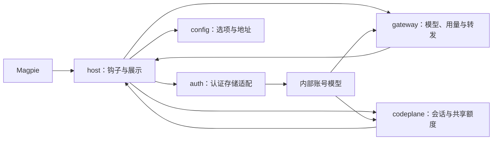

# 架构说明

TET 插件连接模型网关与 TET CodePlane，并将结果适配为 Magpie 的认证、模型和用量钩子。两个服务分别使用自己的地址与凭据。领域术语见 [GLOSSARY.md](../GLOSSARY.md)，配置行为见[登录与配置](configuration.md)。

## 模块与数据流

| 模块         | 职责                                                   | 接收与交付的数据                       |
| ------------ | ------------------------------------------------------ | -------------------------------------- |
| `auth/`      | 校验登录输入，解码和编码宿主认证存储                   | 外部认证记录与 `Account` 判别模型      |
| `config/`    | 校验地址、模型覆盖和选项，填充默认值                   | 外部选项与完整配置                     |
| `gateway/`   | 查询模型和用量，校验目录与额度，转发生成请求           | `GatewayAccess`、目录模型与网关用量    |
| `codeplane/` | 登录和恢复会话，读取分组与上游额度，归一化读数         | `CodePlaneAccount`、分组快照与独立读数 |
| `host/`      | 装配钩子、保存认证、选择 SDK，并生成宿主模型与用量窗口 | 领域数据与 Magpie 契约                 |

外部配置、认证和服务 JSON 在入口校验后形成明确类型。`auth`、`gateway`、`codeplane` 不依赖宿主契约；SDK 选择、模型元数据合并和展示格式集中在 `host`。共享契约放在所属模块的类型文件中，具体字段、单位与错误条件由 JSDoc 说明。

唯一公开导出为 `TetPlugin`。源码和构建产物的入口、文件白名单及发布方式见[开发与验证](development.md#类型与构建)。

## 请求与安全边界

网关地址使用统一规范化规则，CodePlane 地址独立校验。账号地址优先于包级回退，模型元数据不能改变请求去向。

- 查询拒绝重定向；单个响应与累计模型目录均最多 4 MiB，模型目录最多 20 页。分页只能指向同一网关的模型端点，重复、越界或过大目录均失败。
- 同地址、Key、路径和超时的相同查询只合并在途请求，完成后移除，不缓存账号数据。
- 生成转发限定账号的网关地址和路径前缀，只允许已知协议端点。每次发送前读取当前凭据；地址变化时要求重载，避免向原站点发送新站点 Key。
- Magpie 负责协议适配，插件只按协议注入认证头，保留正文、流式响应和取消信号。显式历史和工具结果原样通过，不改写 `store`、`previous_response_id` 或 Compact 请求，也不自动切换协议重试。
- HTTP、网络和协议错误使用安全文本，不透传上游正文。诊断仅保留固定分类、经过校验的状态码和 `Retry-After`；模型不可用只识别有界 JSON 中的固定 `model_not_found` 代码。

目录查询不发送生成请求，也不因一次生成失败永久隐藏模型。模型协议、能力与模态的合并规则见[配置参考](configuration.md#调用协议)。

## 认证生命周期

宿主适配通过 `decodeAuth` 取得 `api-key` 或 `codeplane` 账号。网关只接收 `GatewayAccess`；CodePlane 会话模块接收完整账号，不读取宿主 `metadata`。账号、密码和会话只在该登录项的宿主认证数据中保存，不进入日志或用量结果。

CodePlane 登录校验用户身份、令牌与有效期，并取得网关 Key；缺少 Key 或地址时查询 `/api/auth/profile/gateway-config`。显式填写的网关地址优先于服务端候选。认证存储使用 `metadata.codePlane` 保存站点和账号信息，顶层 `access` 与 `expires` 保存令牌和有效期。宿主 `refresh` 字段是稳定账号标识，不是服务端 refresh token。

会话进入五分钟提前量或已到期时，先查询 `/api/auth/me`。只有有效新令牌或更晚的有效期才算续期；否则使用已保存密码重新登录。服务端提前返回 401 时也恢复会话，并将失败查询重试一次。同一账号的并发恢复合并，失败退避 30 秒；不创建后台轮询。

恢复可以更新网关 Key，但保持已确认的网关地址和账号身份。身份变化要求重新登录；CodePlane 认证失败不将有效网关 Key 标记为过期。

会话模块通过回调交付恢复结果，宿主适配负责账号作用域内的保存。同一账号的并发读取各自调用保存回调；共享网络请求不合并宿主保存动作。保存前重新读取认证，已经退出或替换登录时放弃写回，防止旧查询覆盖新登录。

## 共享额度读取

每轮读取重新获取当前可见分组及关联上游，不在认证中保存固定分组。列表最多 20 页；零分组仍是有效快照。额度按上游账号 ID 查询，而不是按分组 ID 查询；跨分组相同上游只读取一次，再关联回各分组。

同站点、令牌和超时的并发额度读取共享在途快照，完成后移除。单轮请求量为“分组列表页数 + 2 × 不同上游数”，不包含登录、401 后的单次重试和独立的钱包查询。最多同时处理两个上游，即四个指标请求。

恢复、分页及指标请求共用最多五秒的网络预算，配置超时更短时使用更短值；这不限制宿主保存回调自身的耗时。列表失败时不返回旧分组；单个指标失败只使对应读数不可用。辅助查询失败不遮蔽成功的钱包与网关用量。

解析器将非法值、缓存过期、降级、失效重置时间和请求失败归一化为领域状态。超过 15 分钟未更新或超前超过一分钟的缓存不可用于新鲜读数；已过重置时间的非零值不生成百分比。明确的新鲜零值仍有效，但移除失效截止时间与周期推算。缺失读数不补零，重置次数为零时保留零值。

## 宿主展示约束

钱包、真实限额与共享额度保持独立。钱包使用顶层余额；Key 与订阅限额不相加。`quota_limited` 模式只采用 Key 限制，其他模式只展示有效订阅数据。原始 `amount`、`limit` 和 `unit` 保持精度，由宿主绘制进度；未知用量使用文本窗口，避免宿主误归零。

金额展示保留两位小数，非零且绝对值小于 0.01 时使用边界文本。请求数、Token、RPM 和 TPM 使用一位小数紧凑格式；今日、累计消费与流量是辅助信息。共享周期、重置次数和分组并发均标记为 `aside`，不参与 Key 路由。

宿主使用扁平双列，窗口排列保持以下约束：

- 网关限额、消费和流量在共享分组前；前置窗口数量为奇数时，追加真实分组概览，使周期从新行开始。
- 每个上游的 `5 hours`、`7 days` 相邻排列。单上游随后展示分组并发和重置次数；多上游先排列所有周期对，再排列一次分组并发与各上游重置次数，必要时追加来源数量保持下一分组对齐。
- 单分组省略分组前缀，多分组保留分组名，多上游保留来源名。缺少名称或最终标签重名时补编号；层级分隔符先规范化，防止不同来源生成相同指标名。
- 单分组、单上游使用通用周期名；与真实 Key 周期同名时添加分组前缀。无上游仍展示分组并发和“暂无额度来源”。

多个来源的百分比与重置次数不求和。宿主会对等额账号的同名通用周期取平均，该读数不代表去重后的共享容量。同一来源可能出现在多个登录项中；宿主没有独立指标来源 ID 或历史清理接口，来源变化后的历史曲线隔离不作保证。

并发只是读取时的分组快照，不是请求成功率，也可能漏掉瞬时峰值。占用与上限均接受非负安全整数，明确的零上限按原值展示为 `0 / 0` 等文本，不计算百分比，也不推断为无限或额度耗尽；缺失或无效读数显示“暂无数据”。展示尽量使用宿主已有词条，由宿主翻译周期名；自定义选项、错误和部分标题使用英文。

验证方法与覆盖边界见[开发与验证](development.md)，带条件的真实服务结论见[能力记录](capabilities.md)。
